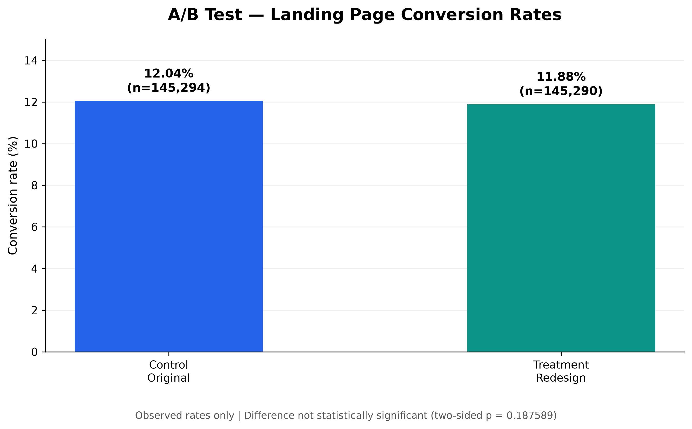
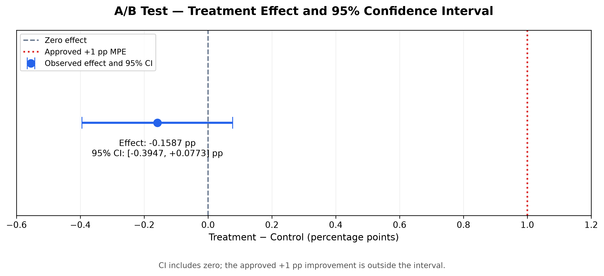
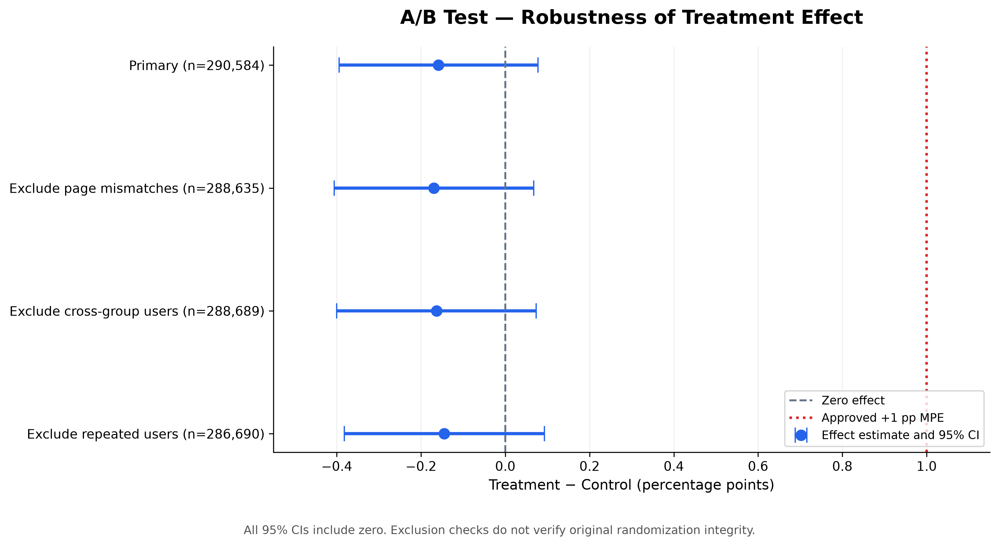

# A/B Test and Experiment Analysis 

**Python | SQL | A/B Testing | Statistical Hypothesis Testing | Product Analytics**

An end-to-end product analytics project evaluating whether a redesigned landing page improves user conversion performance and whether the available evidence supports a product rollout decision.

## Executive Summary

A Product Manager must decide whether to replace an existing landing page with a redesigned version.

Using a public landing-page A/B testing dataset, this project examines conversion performance across control and treatment groups, applies statistical hypothesis testing, evaluates practical significance, and conducts robustness checks.

### Key Results

| Metric | Result |
|---|---:|
| Provisional unique users analyzed | 290,584 |
| Control users | 145,294 |
| Treatment users | 145,290 |
| Control conversions | 17,496 |
| Treatment conversions | 17,265 |
| Control conversion rate | 12.04% |
| Treatment conversion rate | 11.88% |
| Observed treatment effect | −0.1587 percentage points |
| Two-sided p-value | 0.187589 |
| 95% confidence interval | [−0.3947, +0.0773] pp |
| Significance level | 0.05 |
| Approved practical improvement threshold | +1.0 percentage point |

**Business Recommendation: RETAIN ORIGINAL — CONDITIONAL**

The redesigned landing page did not demonstrate a statistically significant improvement in conversion performance. Its observed effect was slightly negative, but the evidence does not establish that the redesign causes harm.

The upper confidence bound is below the approved +1 percentage-point improvement threshold.

The recommendation to retain the original page is conditional on data-quality credibility and operational review.

## 1. Business Problem

The organization tested two landing-page experiences:

- **Control:** Existing landing page.
- **Treatment:** Redesigned landing page.

The central business question is:

**Should the redesigned landing page replace the existing version based on conversion performance?**

The analysis aims to distinguish observed conversion differences from statistical uncertainty and support a defensible product decision.

## 2. Dataset and Data Quality

### Dataset Source and Access

- **Dataset:** `ab_data`
- **Kaggle uploader:** Shubham Jaiswal (`shubhamjaiswal04`)
- **Source:** https://www.kaggle.com/datasets/shubhamjaiswal04/ab-data
- **File:** `ab_data.csv`
- **License displayed on Kaggle:** Apache 2.0

To obtain the dataset, visit the Kaggle source page,
download the dataset, extract `ab_data.csv`, and place
it at `data/ab_data.csv` in the project directory.

The original and processed CSV files are excluded from
this Git repository. The Kaggle listing does not provide
an original data-collection description, so the underlying
experiment provenance and original assignment integrity
cannot be independently verified from the listing alone.

The project uses a public Kaggle landing-page A/B testing dataset.

The source data includes:

- `user_id` — User identifier.
- `timestamp` — Recorded observation time.
- `group` — Control or treatment group.
- `landing_page` — Old or new page.
- `converted` — Binary conversion outcome.

The source dataset contains repeated user IDs, cross-group observations, and group-to-landing-page mismatches.

Because independently verified original assignment and exposure logs were unavailable, the primary analysis uses a documented **provisional user-level assignment rule**.

The earliest recorded observation was used as a provisional proxy where necessary.

This approach supports a transparent educational analysis, but it does not conclusively establish the integrity of the original randomization.

See [Data Quality Report](docs/data_quality_report.md) for the cleaning decisions and limitations.

## 3. Experiment Design

The experiment was evaluated using the following framework:

| Component | Method |
|---|---|
| Primary metric | User-level conversion rate |
| Comparison | Treatment versus control |
| Null hypothesis | Equal conversion probabilities |
| Alternative hypothesis | Conversion probabilities differ |
| Statistical test | Two-sided two-proportion z-test |
| Significance level | 0.05 |
| Confidence interval | 95% Newcombe interval |
| Unit of analysis | Provisional unique user |
| Approved practical improvement threshold | +1 percentage point |

The experiment design also addresses sample ratio mismatch, statistical power, minimum detectable effects, and practical significance.

Observed post-experiment power was not used to justify the result.

See [Experiment Design](docs/experiment_design.md).

## 4. Analytical Workflow

The project follows an end-to-end analytical workflow:

**Business Understanding → Data Acquisition → Data Cleaning → Randomisation Checks → Statistical Testing → Power and MDE Analysis → Robustness Checks → Visualizations → Business Recommendation**

### Data Cleaning and Validation

The analysis investigated repeated user records, inconsistent group assignments, and mismatches between experiment groups and landing pages.

A provisional user-level dataset was constructed and documented.

### Randomisation and SQL Analysis

SQL was used to summarize experiment data and support group-level validation.

The project also evaluated sample allocation and data-quality concerns.

See [SQL Analysis](sql/04_experiment_sql_analysis.sql) and [Randomisation Report](docs/04_randomisation_sql_report.md).

### Statistical Analysis

A two-sided two-proportion z-test was used to assess whether the observed difference in conversion rates was statistically significant.

A 95% Newcombe confidence interval was used to quantify uncertainty around the treatment effect.

The analysis also compared the observed effect with the approved practical improvement threshold.

See [Statistical Analysis Report](docs/05_statistical_analysis_report.md).

## 5. Results and Visualizations

### Visualization 1 — Conversion Rate Comparison



The control group achieved approximately 12.04% conversion, compared with 11.88% for the treatment group.

The observed difference was −0.1587 percentage points in favor of the original page.

This numerical difference was not statistically significant at the 5% level.

### Visualization 2 — Treatment Effect and Confidence Interval



The estimated treatment effect was −0.1587 percentage points.

The 95% confidence interval extended from −0.3947 to +0.0773 percentage points.

Because the interval includes zero, the results do not establish a statistically significant difference.

The interval's upper bound is also below the approved +1 percentage-point practical improvement threshold.

This finding should not be interpreted as proof that the two landing pages are equivalent.

### Visualization 3 — Robustness Comparison



Four analysis specifications were compared:

| Analysis | Users | Effect (pp) | 95% CI (pp) |
|---|---:|---:|---|
| Primary | 290,584 | −0.1587 | [−0.3947, +0.0773] |
| Exclude page mismatches | 288,635 | −0.1695 | [−0.4062, +0.0672] |
| Exclude cross-group users | 288,689 | −0.1633 | [−0.4000, +0.0735] |
| Exclude repeated users | 286,690 | −0.1447 | [−0.3821, +0.0927] |

All four estimated effects were slightly negative, and all four confidence intervals included zero.

These are sensitivity analyses of the same underlying experiment, not four independent experiments. They do not independently verify original randomization integrity.

See [Robustness and Decision Report](docs/07_robustness_decision_report.md).

## 6. Power, MDE, and Business Impact

The project examined statistical power, minimum detectable effects (MDE), sample-size considerations, and practical significance.

The approved primary practical improvement threshold was +1 percentage point.

Financial scenarios were treated as hypothetical planning exercises because the dataset does not contain verified revenue per conversion, contribution profit, or implementation costs.

No realized revenue increase, profitability improvement, or return on investment is claimed.

See [Power, MDE, and Business Impact Report](docs/06_power_mde_business_impact_report.md).

## 7. Final Business Recommendation

### RETAIN ORIGINAL — CONDITIONAL

The available evidence does not justify deploying the redesigned landing page under the approved practical improvement criterion.

For the current rollout decision, the recommended action is to retain the original landing page, subject to data-quality credibility and operational review.

Recommended next actions:

1. Investigate original randomization and exposure logs.
2. Review tracking instrumentation and assignment consistency.
3. Consider a new properly randomized experiment if the redesign remains strategically important.
4. Use prospective sample-size planning for future experiments.
5. Obtain verified financial data before estimating profitability or ROI.

The decision reflects statistical uncertainty, practical significance, robustness findings, and data-quality limitations rather than relying on the p-value alone.

Read the [Product Manager Decision Memo](docs/08_product_manager_decision_memo.md) for the executive recommendation.

## 8. Tools and Technologies

- **Python:** Data processing and statistical analysis.
- **pandas and NumPy:** Data cleaning, transformation, and aggregation.
- **SciPy and statsmodels:** Statistical testing and confidence intervals.
- **Matplotlib:** Statistical visualizations.
- **SQL:** Experiment summaries and validation queries.
- **Jupyter Notebook:** Documented analytical workflow.
- **Git and GitHub:** Version control and project presentation.
- **VS Code:** Development environment.

## 9. Repository Structure

```text
ab-test-experiment-analysis/
├── data/
│   └── processed/
├── docs/
│   ├── experiment_design.md
│   ├── data_quality_report.md
│   ├── 04_randomisation_sql_report.md
│   ├── 05_statistical_analysis_report.md
│   ├── 06_power_mde_business_impact_report.md
│   ├── 07_robustness_decision_report.md
│   └── 08_product_manager_decision_memo.md
├── figures/
│   ├── 08_conversion_rate_comparison.png
│   ├── 08_treatment_effect_ci.png
│   └── 08_robustness_comparison.png
├── notebooks/
│   ├── 02_data_first_look.ipynb
│   ├── 03_data_cleaning_validation.ipynb
│   ├── 05_core_statistical_analysis.ipynb
│   ├── 06_power_mde_business_impact.ipynb
│   ├── 07_robustness_decision_framework.ipynb
│   └── 08_visualizations_decision_memo.ipynb
├── sql/
│   └── 04_experiment_sql_analysis.sql
├── requirements.txt
├── .gitignore
└── README.md
```

The repository also contains supporting folders. Dataset availability and reproducibility instructions are subject to final Phase 09 verification.

## 10. Reproducibility

The analysis was developed using Python 3.13.15 and a virtual environment on Windows.

The project includes Python notebooks, SQL analysis, supporting documentation, and dependency information in `requirements.txt`.

Reproducing the complete analysis requires the appropriate source dataset, the documented cleaning process, and the required Python dependencies.

**Reproducibility status:** Final dependency, dataset-distribution, and execution-order verification is part of Phase 09. Full end-to-end reproducibility is not yet independently confirmed.

## 11. Project Limitations

The analysis has several important limitations:

- Original assignment and exposure logs were unavailable.
- Provisional user-level assignments cannot conclusively verify randomization integrity.
- The source data contained repeated users and inconsistent observations.
- Robustness checks do not eliminate all possible assignment or instrumentation concerns.
- Statistical non-significance is not proof of equivalence.
- Financial outcomes were not independently verified.

These limitations are explicitly considered in the final business recommendation.

## 12. Key Takeaways

This project demonstrates how product analytics combines business understanding, SQL, Python, statistical inference, data-quality assessment, and practical decision-making.

The main lesson is that a product rollout decision should not be based only on which variation has the higher observed conversion rate.

A responsible recommendation must also consider statistical uncertainty, meaningful improvement thresholds, experimental validity, and operational context.

---

**Project Type:** Independent educational data analytics portfolio project

**Focus Areas:** Product Analytics, A/B Testing, Experimentation, Statistical Inference, Business Decision-Making
